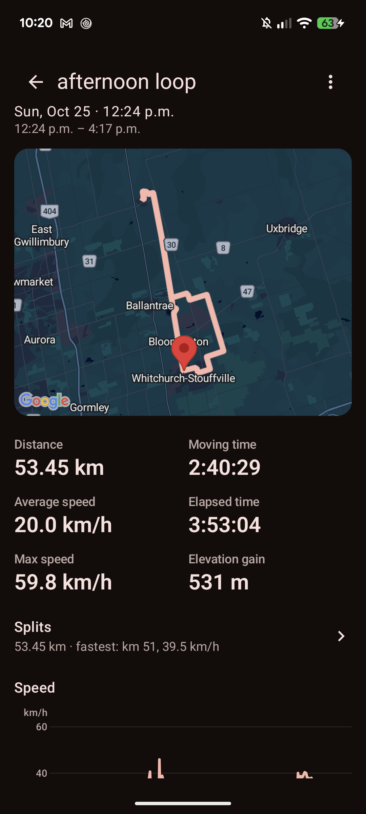
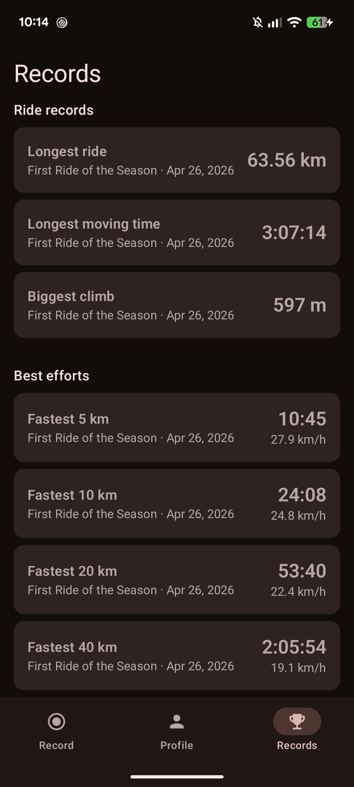
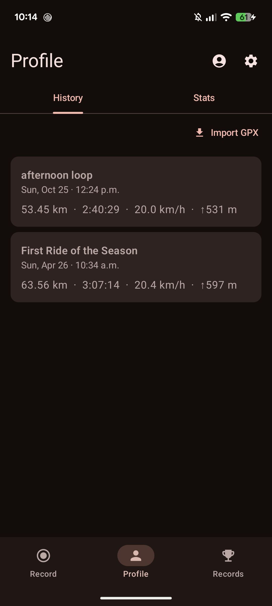
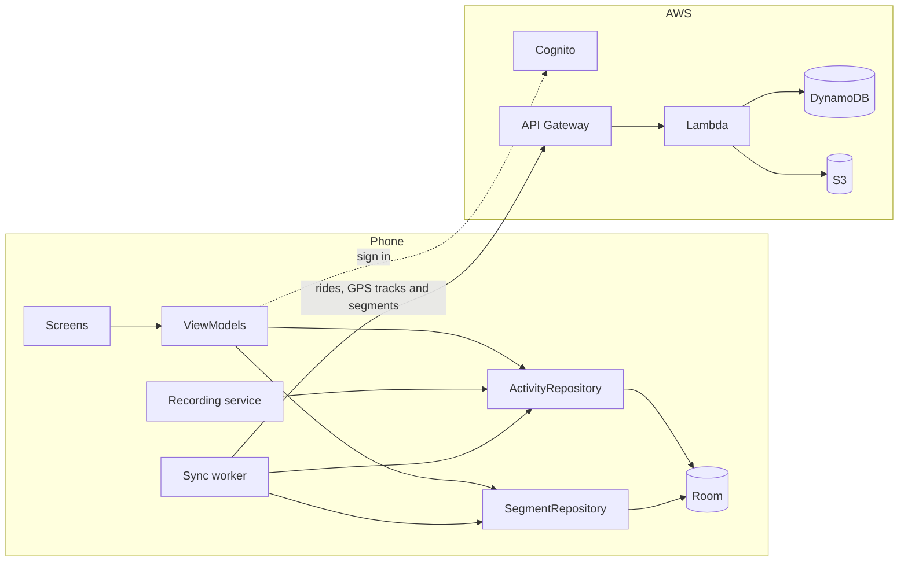

# Activity Stats

[](https://github.com/danielbrog/activity-stats/actions/workflows/pr-checks.yml)

I built this Android app to track my bike rides. It records a ride with the phone's GPS, keeps it on the phone, and syncs it to a small AWS backend I set up, so my rides are backed up and come back if I change phones.

**Download:** the APK is on the [Releases](https://github.com/danielbrog/activity-stats/releases) page, for Android 8.0 or newer. It's a pre-release, still being tested.

| Record | Ride detail | Records | Profile | Settings |
|:---:|:---:|:---:|:---:|:---:|
|  |  |  |  |  |

## What it does

**Recording a ride**
- Shows time, distance, current and average speed (or pace), and max speed while I ride, with the route drawn on a map.
- Turns the GPS on as soon as the Record screen is open, and shows how accurate it is, so the start of the ride isn't spoiled by a bad first fix.
- Auto-pause stops the timer when I stop. I can also pause by hand, which turns the GPS off until I resume.
- When I press Finish, it pauses and asks for a name before saving.
- Keeps recording with the screen off. The notification has Pause/Resume and Finish buttons.

**Looking back at rides**
- Each ride has a map, km or mile splits, speed and elevation charts, and total climbing.
- Records shows my longest ride, longest moving time and biggest climb, plus my fastest 5, 10, 20 and 40 km (or 5, 10 and 25 mi) from any ride.
- Rides can be exported as GPX files, which Strava, Komoot and Garmin Connect can open. GPX files can be imported too.
- Rides can be renamed or deleted. A delete can be undone.

**Segments**
- I can make a segment from any part of a ride, picking its start and end on the map.
- Every ride that covers it, in the same direction and without stopping, gets an effort with its time. A ride that laps a segment gets one effort per lap.
- A segment's page shows its line, distance, best time and every effort. A ride's page shows its efforts too.
- Segments can be renamed or deleted, like rides.

**Sync** (optional; everything else works without an account)
- I sign in through Amazon Cognito. Rides upload when I finish, rename or delete them, and the app syncs whenever I open it.
- On a new phone, signing in brings my rides back, maps included.
- Segments sync the same way.
- Each ride shows whether it's synced. The Account screen shows when the last sync happened, and has a Sync now button.

**Settings**
- km or miles, speed or pace, and auto-pause on or off. Every screen uses these, including the notification and the charts.

## What it's built with

- **App:** Kotlin and Jetpack Compose. Room stores rides, DataStore stores settings, and WorkManager runs sync in the background. Google's fused location provider supplies GPS. Maps use Maps Compose, and sign-in uses AppAuth.
- **Backend:** written with the AWS CDK in TypeScript. API Gateway passes requests to six small Lambda functions. Ride summaries, segments and per-account usage counts go in DynamoDB, and the GPS tracks go in S3, checked by the server before they're stored. Cognito handles sign-in, using OAuth 2.0 with PKCE, and its JWTs are checked by API Gateway before any function runs. A few CloudWatch alarms and a $5 monthly budget email me if something goes wrong.
- **Tests:** JUnit for the app logic, Room tests that run on the phone, and Jest for the backend.

## How it fits together



| Folder | What's in it |
|---|---|
| `location/` | The recording service, the GPS filter, and the GPS warm-up |
| `stats/` | Distance, speed, splits, best efforts and climbing, and all unit formatting |
| `data/` | The Room database and the repositories |
| `segments/` | Matching segments against rides, simplifying their lines, and the segment screens |
| `sync/` | Uploading, downloading and merging rides and segments |
| `account/` | Sign-in |
| `live/`, `history/`, `profile/`, `records/`, `settings/` | The screens |
| `navigation/`, `ui/` | Moving between screens, and shared pieces like the map with its details sheet |
| `export/` | GPX reading and writing |

There's more about the backend in [`backend/README.md`](backend/README.md).

## Problems I had to solve

**GPS noise.** Phone GPS jumps around, especially when you're standing still, and that adds fake distance. [`GpsFilter`](app/src/main/java/com/danielbrog/activitystats/location/GpsFilter.kt) ignores fixes that are less accurate than ±20 m. It also ignores fixes that have moved less than their own accuracy from the last good fix, while going slower than 0.5 m/s. The ignored fixes are still saved, so I can change the filter later and re-run it on old rides.

**Pausing.** If I pause and then move the bike, by walking it or putting it in a car, that distance shouldn't count. Each time I resume, the ride starts a new stretch. Distance, time, splits, best efforts and charts never measure across the gap between stretches. GPX export writes each stretch as its own track segment.

**Sync without losing anything.** The phone has to work offline and catch up later:
- Each ride's GPS track uploads before its summary, so a ride in the cloud always has its track.
- If the same ride was changed in two places, the most recently edited copy wins.
- If I rename a ride while it's uploading, the rename isn't lost. A ride is only marked as synced if it hasn't changed since it was sent.
- When downloading, the app re-reads the last 5 minutes before where it left off. DynamoDB's index can show a new ride slightly late, and this stops one from being skipped.

The upload, download and merge logic is plain Kotlin, tested against a fake server ([`Uploader`](app/src/main/java/com/danielbrog/activitystats/sync/Uploader.kt), [`Downloader`](app/src/main/java/com/danielbrog/activitystats/sync/Downloader.kt), [`Merge`](app/src/main/java/com/danielbrog/activitystats/sync/Merge.kt)).

**Not losing a ride if the app dies.** GPS points are saved every 10 points or 10 seconds while riding. If the app is killed or the battery runs out, the next time it opens it finishes the ride from the points that were saved.

**Matching segments.** A segment is a line, and a ride counts as covering it only if it really rode that line. [`SegmentMatcher`](app/src/main/java/com/danielbrog/activitystats/segments/SegmentMatcher.kt) looks for the ride passing within 25 m of the start and then the end, and between them:
- passing the points a quarter, half and three quarters of the way along, in order, so a loop ridden the other way round doesn't count;
- keeping at least 90% of its GPS fixes within 25 m of the line, so a different road joining the same two ends doesn't count;
- riding a distance within 10% of the segment's, measured on lines simplified the same way so GPS wobble doesn't matter;
- never stopping for 5 seconds or more, the same rule auto-pause uses.

It all runs on the phone, from the saved points, so changing the rules later just means re-running them on old rides.

**Keeping a public backend safe and cheap.** Anyone with the APK can make an account, so the server can't trust what it's sent:
- Track uploads go through the API and are checked before they're stored: at most 1 MB, they must unzip within 8 MB (so a "zip bomb" is refused), and every point must be sane. A clean copy is stored, not what was sent.
- Downloads go through the API too, rather than a link to S3, so each one can be counted.
- Each account has limits, kept in a `Usage` table: 10 new rides a week, 500 track downloads and 200 edits a day for now ([`usage.ts`](backend/lambda/usage.ts)). Each count is one conditional update, so two requests at once can't both take the last place. Past a limit the phone keeps the change waiting and books a sync for just after the reset.
- Each Lambda function may only touch what it needs, alarms email me when something fails, and a $5 monthly budget warns me if costs climb.

**Units.** All conversions between km, miles, metres and feet happen in one place, [`Format`](app/src/main/java/com/danielbrog/activitystats/stats/Format.kt), so the screens, charts and notification always agree.

## Tests

- 360+ unit tests in `app/src/test`. They cover the stats, the GPS filter, splits, best efforts, GPX, segments and sync. They run on the computer, no phone needed.
- Tests in `app/src/androidTest` that run against the real database on a phone.
- Tests in `backend/test` that check the AWS setup, for example that every API route needs sign-in, plus the Lambda functions.

```bash
./gradlew testDebugUnitTest            # unit tests
./gradlew connectedDebugAndroidTest    # on-device tests (phone or emulator connected)
cd backend && npm test                 # backend tests
```

The Kotlin code is formatted with [ktlint](https://pinterest.github.io/ktlint/), using the rules in [`.editorconfig`](.editorconfig) (which Android Studio follows too). ktlint also runs the [Compose rules](https://mrmans0n.github.io/compose-rules/), which catch Compose mistakes such as a missing `Modifier` parameter or an effect holding on to an old callback:

```bash
./gradlew ktlintCheck                  # report anything off-style
./gradlew ktlintFormat                 # fix what it can
```

## Building from source

To just use the app, get the APK from [Releases](https://github.com/danielbrog/activity-stats/releases). To build it:

1. Open the project in Android Studio.
2. Add a Google Maps API key to `local.properties` (git-ignored; [`secrets.defaults.properties`](secrets.defaults.properties) lists the keys it can hold): `MAPS_API_KEY=...`
3. Run it. Recording, rides, records and segments all work without a backend.

Sync is optional: deploy your own backend ([`backend/README.md`](backend/README.md)) and add its outputs to `local.properties` as `COGNITO_DOMAIN` (`SignInUrl`), `COGNITO_CLIENT_ID` (`AppClientId`) and `SYNC_API_URL` (`ApiUrl`). Signed release builds are in [`docs/release.md`](docs/release.md).

My own account details only live in git-ignored files, and [`scripts/scan_secrets.py`](scripts/scan_secrets.py) checks every change for them before I push.

## License

[MIT](LICENSE)
