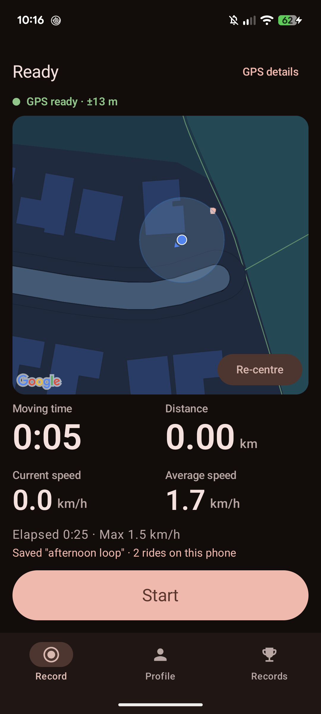
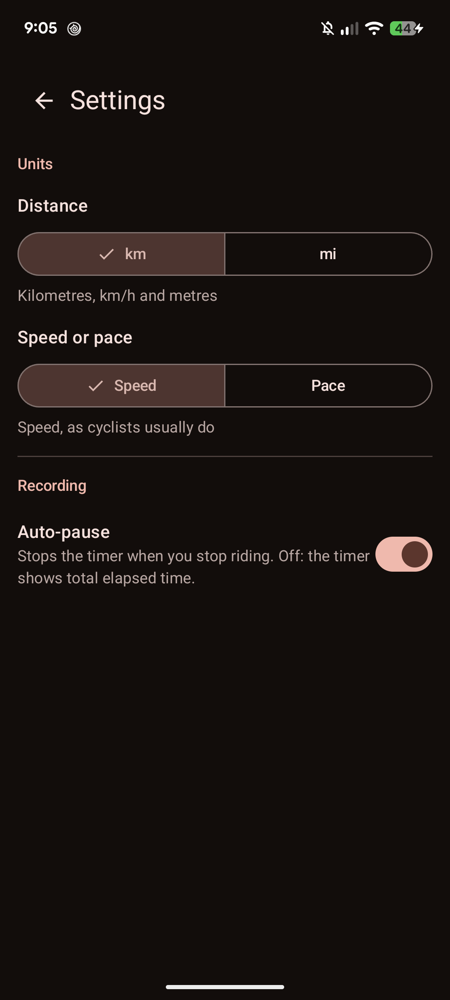
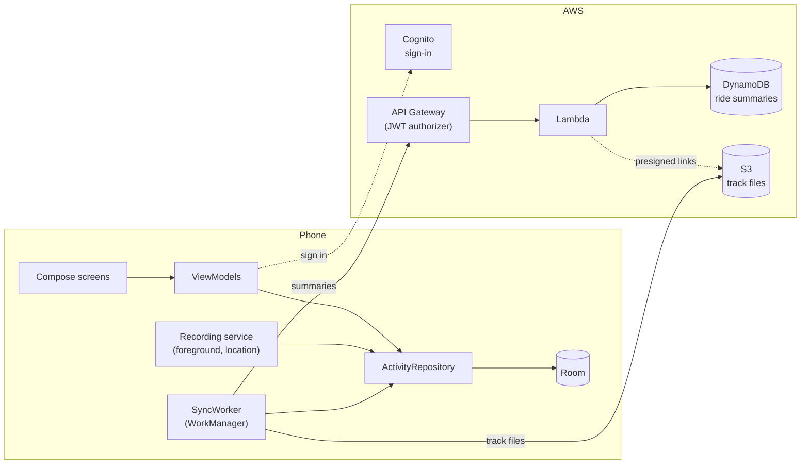

# Activity Stats

An offline-first Android cycling tracker. It filters out GPS noise, handles manual pause and auto-pause, and syncs rides to a serverless AWS backend.


<!-- Demo: a 15–30 s recording of Record → Finish → History → ride detail → sync.
     Save it as docs/images/demo.gif (or upload an MP4 to a GitHub issue and paste its link here). -->
<p align="center">
  
</p>

<!-- Screenshots: add these files to docs/images/. Use a ride that doesn't start at home,
     and keep the Account screen (your email) out of them. -->
| Record | Ride detail | Records | Profile | Settings |
|:---:|:---:|:---:|:---:|:---:|
|  |  |  |  |  |

---

## Features

**Recording**
- Large live stats: time, distance, current and average speed (or pace), and max speed. A live map draws the route as you go.
- The GPS warms up before you press Start. A status line reads *Finding GPS…*, *GPS weak*, or *GPS ready ±4 m*, so the first fixes of a ride are already accurate.
- **Auto-pause** stops the timer when you stop. **Manual pause** turns the GPS off and freezes the timers.
- **Finish** pauses the ride and asks for its name before saving.
- Recording carries on with the screen off. A foreground-service notification has Pause/Resume and Finish buttons.

**History and stats**
- Every ride has a map, splits by km or mile, speed and elevation charts, and the climbing total.
- **Best efforts:** your fastest 5/10/20/40 km and 5/10/25 mi within any ride. **Personal records** cover your longest ride, longest moving time and biggest climb.
- **GPX export** works with Strava, Komoot and Garmin Connect. **GPX import** keeps the original's pauses as separate track segments.
- You can rename or delete a ride, and undo the delete.

**Cloud sync** (optional; the app works fully without an account)
- Sign in with an account hosted by AWS Cognito, using the authorization code flow with PKCE.
- Rides upload when you finish, rename or delete them, and sync whenever the app comes to the screen.
- **Restore:** sign in on a new phone and your rides come back, maps included.
- Each ride shows its sync state (synced, waiting, or refused). The Account screen shows the last sync time and a **Sync now** button.

**Settings**
- Choose km or miles, speed or pace, and auto-pause. The whole app follows the choice, including the notification and the charts.

---

## Tech stack

| | |
|---|---|
| **Android** | Kotlin · Jetpack Compose (Material 3) · Room · DataStore · WorkManager · Navigation Compose (type-safe routes) · Play Services Location (fused provider) · Maps Compose · AppAuth (PKCE) · kotlinx-serialization |
| **Backend** | AWS CDK (TypeScript) · API Gateway HTTP API with a Cognito JWT authorizer · Lambda (Node.js 22, arm64) · DynamoDB · S3 (presigned uploads and downloads) · Cognito · CloudWatch alarms → SNS email · AWS Budgets |
| **Testing** | JUnit with in-memory fakes for the server and database · Room tests on a device · Jest for the backend |

---

## Architecture



| Package | What's in it |
|---|---|
| `location/` | The recording service, the GPS noise filter, the GPS warm-up, live tracking state |
| `stats/` | The stats engine, splits, best efforts, climbing, chart series, and all unit formatting |
| `data/` | Room entities and DAOs, the repository, crash recovery |
| `sync/` | Upload, download and merge, the sync worker, sync status, the track file format |
| `account/` | Sign-in with AppAuth, token storage encrypted with Android Keystore |
| `live/`, `history/`, `profile/`, `records/`, `settings/` | The screens |
| `export/` | Writing and reading GPX |

The backend is documented in [`backend/README.md`](backend/README.md).

---

## Engineering highlights

### Trusting GPS
Phones report noisy positions, especially when standing still. [`GpsFilter`](app/src/main/java/com/danielbrog/activitystats/location/GpsFilter.kt) drops fixes worse than ±20 m. It also drops slow "wander": a fix that has moved less than its own accuracy radius from the last kept fix, at under 0.5 m/s. Dropped fixes are **still saved** with their status, so the filter can be re-tuned and re-run on old rides later.

### Pauses that don't lie
Each manual Resume starts a new track **segment**. Distance, moving time, splits, best efforts and charts never measure across a segment break, so putting the bike on a car while paused can't produce a 10 km "best effort". Segments carry through to GPX (one `<trkseg>` each) and to the cloud track file.

### Offline-first sync
- **The track goes up before the summary.** A ride in the cloud always has its track there too.
- **The newest `updatedAt` wins** on both sides.
- **Edits made mid-upload aren't lost.** A ride is only marked synced, or refused, if it hasn't changed since that copy was sent.
- **Downloads read back over a 5-minute overlap.** DynamoDB's secondary index is eventually consistent, so a ride can be listed late, or share a timestamp with another. Re-reading a ride is harmless.
- **Logic stays separate from the network.** [`Uploader`](app/src/main/java/com/danielbrog/activitystats/sync/Uploader.kt), [`Downloader`](app/src/main/java/com/danielbrog/activitystats/sync/Downloader.kt) and [`decide()`](app/src/main/java/com/danielbrog/activitystats/sync/Merge.kt) are plain Kotlin, tested against fake servers.

### Never losing a ride
Points are saved in batches every 10 fixes or 10 seconds while you ride. If the app is killed or the battery dies, unfinished rides are rebuilt from their saved points the next time the app starts, using the same stats engine as live recording.

### One source of truth for units
Every km, mile, metre and foot goes through [`Format`](app/src/main/java/com/danielbrog/activitystats/stats/Format.kt). Each conversion is an exhaustive `when` over the unit, so adding a unit won't compile until every conversion handles it. The charts and the notification can't drift from the numbers on screen.

---

## Testing

- **230+ unit tests** (`app/src/test`). The logic is plain Kotlin with no Android dependencies: the stats engine, the GPS filter, splits, best efforts, GPX, the track file format, upload, download, merge and sync status. They run on the JVM with in-memory fakes.
- **On-device tests** (`app/src/androidTest`). These check the real Room queries: finishing, crash recovery, sync states and counts.
- **Backend tests** (`backend/test`). These cover the CDK stack, checking permissions, alarms and that every route needs sign-in, plus each Lambda handler.

```bash
./gradlew testDebugUnitTest            # unit tests
./gradlew connectedDebugAndroidTest    # on-device tests (phone or emulator connected)
cd backend && npm test                 # backend tests
```

---

## Build it yourself

1. Open the project in Android Studio (AGP 9.5, Kotlin 2.4). Gradle uses Android Studio's bundled JDK.
2. Add a Google Maps key to `local.properties`. This file is git-ignored; [`secrets.defaults.properties`](secrets.defaults.properties) lists the keys.
   ```properties
   MAPS_API_KEY=your-google-maps-key
   ```
3. Run the app. **No backend is needed.** Recording, history and records all work offline, and the Account screen says sign-in isn't set up.
4. *(Optional)* For cloud sync, deploy the backend ([`backend/README.md`](backend/README.md)). Then add its outputs to `local.properties`:
   ```properties
   COGNITO_DOMAIN=https://<prefix>.auth.<region>.amazoncognito.com
   COGNITO_CLIENT_ID=<AppClientId>
   SYNC_API_URL=<ApiUrl>
   ```

Account-specific values stay in git-ignored files. [`scripts/scan_secrets.py`](scripts/scan_secrets.py) checks every branch for them before it's pushed, without ever printing them.

---

## How it was built

I built this with an AI coding assistant (Claude Code), working in small, reviewed steps:

- **Each feature was planned first**, then approved, then built on its own branch and merged through a pull request.
- **Two custom review agents** ([`.claude/agents/`](.claude/agents)) run before every PR:
  - `code-improver` reviews the change for bug risks, Android and Compose habits, and Kotlin style.
  - `release-checker` runs the build, tests and lint, and the secret scan.
- **Their findings** were triaged by hand, then fixed or declined.
- **Every feature was tested on a Pixel 7** before merging, including the on-device tests.

The decisions, reviews and testing were mine. The assistant wrote most of the code to those decisions.

---

## Known limitations and roadmap

- The **Stats** tab in Profile is a placeholder.
- From a full code review, still to fix:
  - Climbing can count height changes across a manual pause.
  - The "location is off" warning is only checked when a ride starts.
  - Imported runs and walks count towards cycling records.
- Deleting a ride doesn't yet delete its track file from the cloud.
- Not yet on Google Play. For now, release builds are planned as signed APKs on GitHub Releases.

---

## License

[MIT](LICENSE)
